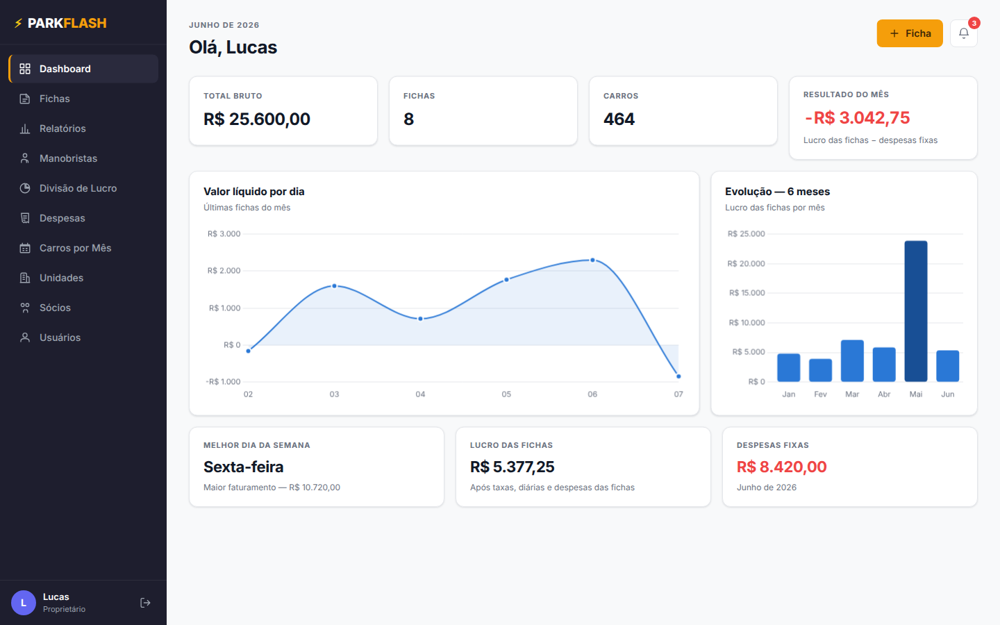
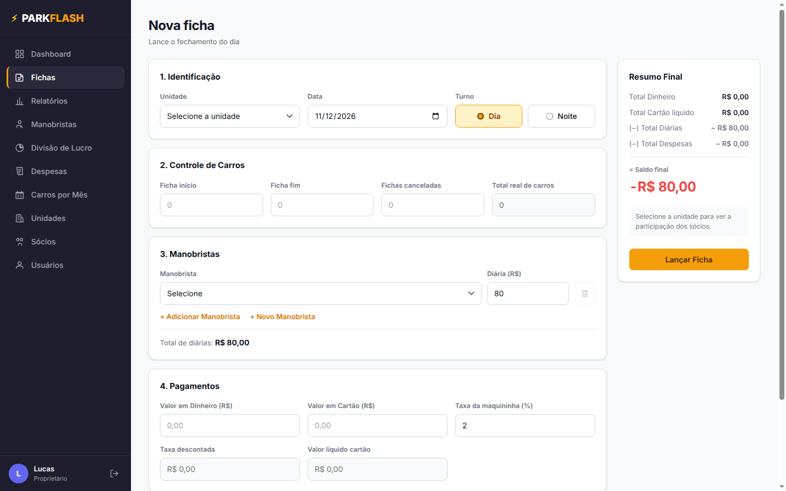
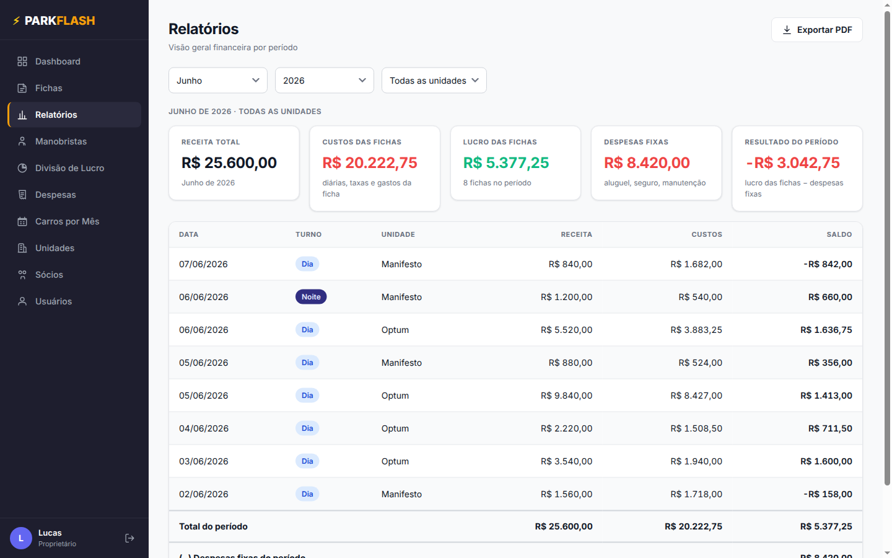
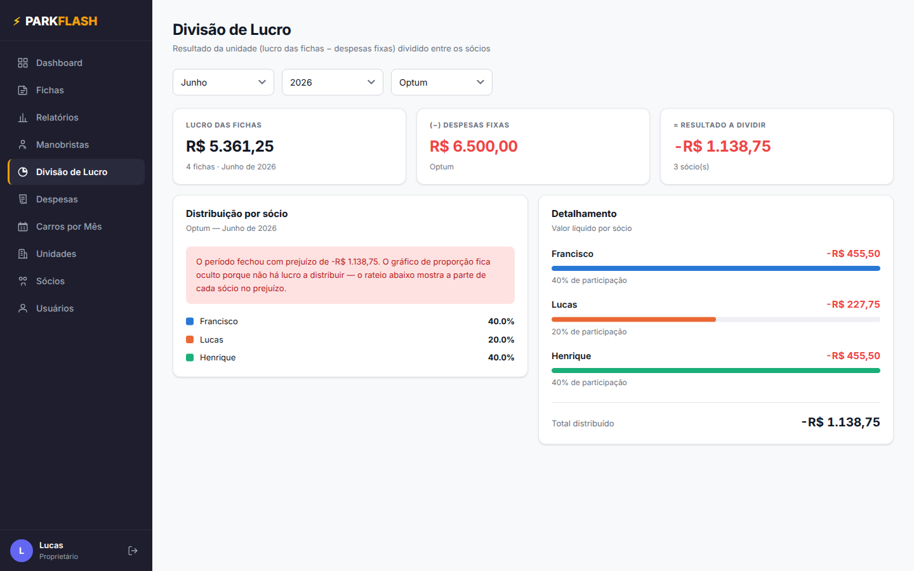
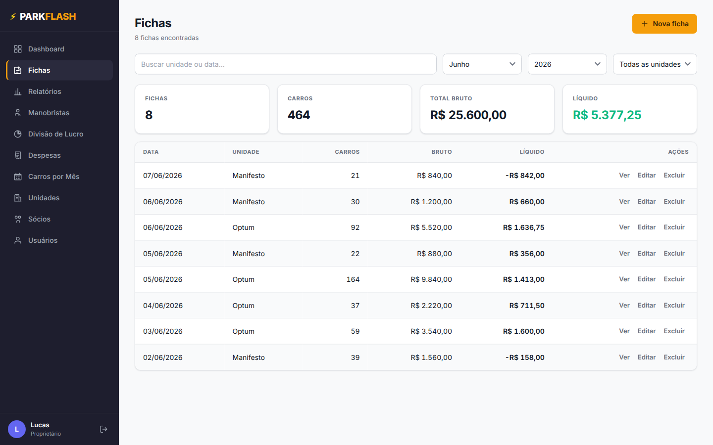
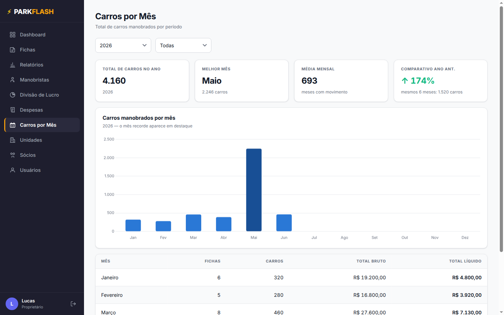
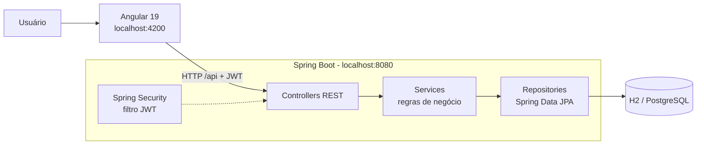

<div align="center">

# ⚡ ParkFlash

**Sistema de gestão financeira para estacionamentos com serviço de manobrista**

Lançamento das fichas diárias, controle de manobristas e despesas, relatórios e divisão de lucro entre sócios.




</div>

---

## Sumário

- [Sobre o projeto](#sobre-o-projeto)
- [Funcionalidades](#funcionalidades)
- [Telas](#telas)
- [Tecnologias](#tecnologias)
- [Arquitetura](#arquitetura)
- [Como rodar](#como-rodar)
- [Usuários de demonstração](#usuários-de-demonstração)
- [Regras de negócio](#regras-de-negócio)
- [API REST](#api-rest)
- [Segurança](#segurança)
- [Testes](#testes)
- [Configuração](#configuração)
- [Estrutura de pastas](#estrutura-de-pastas)
- [Autor](#autor)

## Sobre o projeto

Em estacionamentos com manobristas, o fechamento de cada turno costuma ser feito em fichas de papel:
quantos carros entraram, quanto foi recebido em dinheiro e cartão, quanto se pagou de diária aos
manobristas e quais despesas surgiram. No fim do mês, alguém ainda precisa somar tudo, descontar
aluguel e seguro e dividir o resultado entre os sócios de cada unidade.

O **ParkFlash** digitaliza esse processo. O operador lança a ficha do turno, o sistema calcula
os totais e gera em tempo real os indicadores, relatórios e a divisão de lucro de cada sócio.

Projeto acadêmico desenvolvido com **Angular** no front end e **Java (Spring Boot)** no back end.

## Funcionalidades

- 📊 **Dashboard**: faturamento, fichas, carros, resultado do mês, gráficos e alertas.
- 📝 **Fichas**: lançamento por unidade e turno, com cálculo automático de carros, taxa da maquininha, diárias e saldo.
- 📈 **Relatórios**: resultado por período e unidade, com exportação em PDF.
- 🧑‍✈️ **Manobristas**: cadastro e extrato mensal de dias trabalhados e diárias.
- 💸 **Despesas fixas**: aluguel, seguro e manutenção, descontados do resultado.
- 🤝 **Divisão de lucro**: rateio do resultado entre os sócios de cada unidade, por percentual.
- 🚗 **Carros por mês**: comparativo mensal e anual de movimento.
- 🏢 **Unidades, sócios e usuários**: cadastros com validação.
- 🔐 **Três níveis de acesso**: Proprietário, Gerente e Operador, com permissões checadas no servidor.
- 📱 **Responsivo**: sidebar no desktop e navegação inferior no celular.

## Telas

| Login | Nova ficha |
|---|---|
|  |  |

| Relatórios | Divisão de lucro |
|---|---|
|  |  |

| Fichas | Carros por mês |
|---|---|
|  |  |

<div align="center">
  
  &nbsp;&nbsp;
  
  <p><em>Versão mobile</em></p>
</div>

## Tecnologias

| Camada | Tecnologias |
|---|---|
| **Front end** | Angular 19 (standalone components, signals, Reactive Forms, lazy loading), TypeScript, SCSS com design tokens, Chart.js 4, Angular CDK |
| **Back end** | Java 17, Spring Boot 3.5, Spring Web, Spring Data JPA, Bean Validation, Maven |
| **Banco de dados** | H2 em arquivo (desenvolvimento) e PostgreSQL (perfil `postgres`), com migrações Flyway |
| **Segurança** | Spring Security, JWT (JJWT), senhas com BCrypt |
| **Documentação** | Swagger UI (springdoc-openapi) |
| **Testes** | Jasmine + Karma (front), JUnit 5 + MockMvc (back) |

## Arquitetura



- O **front end** cuida da interface e guarda apenas o token de sessão no navegador.
- O **back end** é a fonte da verdade: valida os dados, aplica as permissões e recalcula todos os valores.
- O **Flyway** cria as tabelas e carrega os dados de demonstração na primeira execução.

## Como rodar

**Pré-requisitos:** Java 17+ e Node.js 18+. Não é preciso instalar Maven nem banco de dados.

```bash
# 1) Back end (terminal 1): http://localhost:8080
cd backend
./mvnw spring-boot:run          # Windows: mvnw.cmd spring-boot:run

# 2) Front end (terminal 2): http://localhost:4200
npm install
npm start
```

Abra **http://localhost:4200** e entre com um dos [usuários de demonstração](#usuários-de-demonstração).
A documentação interativa da API fica em **http://localhost:8080/swagger-ui.html**.

> O `npm start` usa o `proxy.conf.json`, que encaminha `/api` para a porta 8080 (sem problemas de CORS).
> Para restaurar os dados de demonstração, pare o back end e apague a pasta `backend/data/`.

<details>
<summary><strong>Usando PostgreSQL</strong></summary>

O jeito mais rápido é com o `docker-compose.yml` do repositório (precisa só do Docker):

```bash
# 1) sobe o PostgreSQL na porta 5432 com o banco `parkflash` já criado
docker compose up -d

# 2) roda o back end com o perfil postgres
cd backend
SPRING_PROFILES_ACTIVE=postgres JWT_SEGREDO=um-segredo-longo-com-32-caracteres-ou-mais \
  DB_USUARIO=parkflash DB_SENHA=parkflash ./mvnw spring-boot:run
```

As migrações Flyway criam as tabelas e carregam os dados de demonstração automaticamente.
`docker compose down` para o banco; `docker compose down -v` apaga os dados também.

Sem Docker, vale o mesmo caminho com um PostgreSQL instalado: `createdb parkflash` e ajuste
`DB_URL`, `DB_USUARIO` e `DB_SENHA`.

> Para um deploy de verdade, basta apontar `DB_URL` para o PostgreSQL do servidor —
> o mesmo perfil `postgres` serve. O front é publicado com `npm run build` (pasta `dist/`).
</details>

## Usuários de demonstração

Todos usam a senha **`123456`**, que pode ser trocada em **Meu perfil**.

| Usuário | Nível | O que acessa |
|---|---|---|
| `lucasrodrigues.10@icloud.com` | Proprietário | tudo |
| `pedro@email.com` | Gerente | tudo, menos Sócios, Usuários e Divisão de Lucro |
| `dario@email.com` | Operador | Fichas (lançar), Manobristas e Meu perfil |

## Regras de negócio

Os cálculos são feitos no servidor (`CalculoFicha.java`, com `BigDecimal` e arredondamento em 2 casas).
O front (`calc.ts`) usa as mesmas fórmulas apenas para a prévia enquanto o usuário digita.

```
totalCarros     = fichaFim − fichaInício − canceladas
taxaDescontada  = valorCartão × (taxa / 100)
líquidoCartão   = valorCartão − taxaDescontada
saldoFinal      = dinheiro + líquidoCartão − totalDiárias − totalDespesas
lucroFichas     = Σ saldoFinal das fichas do período
resultado       = lucroFichas − despesas fixas
divisãoSócio    = resultado da unidade × (percentual do sócio / 100)
```

Validações aplicadas no servidor:

- Não pode haver duas fichas com a mesma data, unidade e turno.
- O mesmo manobrista não pode aparecer duas vezes na ficha.
- O percentual de cada sócio fica entre 0% e 100%. A tela de Sócios avisa quando o rateio de uma unidade não soma 100%.
- E-mail de usuário é único.
- Unidade ou manobrista com histórico não pode ser excluído.
- Os totais enviados pelo front são ignorados: o servidor recalcula tudo.

## API REST

| Método e rota | Quem pode |
|---|---|
| `POST /api/auth/login` | público |
| `GET /api/auth/me` · `PUT /api/auth/senha` | qualquer usuário logado |
| `GET /api/fichas`, `/unidades`, `/manobristas`, `/socios` | todos os níveis |
| `POST /api/fichas` · `POST/PUT /api/manobristas` | todos os níveis |
| `PUT/DELETE /api/fichas/{id}` · CRUD `/api/unidades` e `/api/despesas` · `DELETE /api/manobristas/{id}` | Gerente e Proprietário |
| `GET /api/relatorios/resumo?ano=&mes=&unidadeId=` | Gerente e Proprietário |
| CRUD `/api/usuarios` · `POST/PUT/DELETE /api/socios` · `GET /api/relatorios/divisao-lucro` | Proprietário |

Os erros seguem um formato padrão, `{ "status", "mensagem", "campos" }`: 400 (validação), 401 (sem login),
403 (sem permissão), 404 (não encontrado) e 409 (conflito). O front mostra a `mensagem` num aviso.

## Segurança

- **Login com JWT:** `POST /api/auth/login` devolve um token assinado, enviado no cabeçalho `Authorization` de cada requisição.
- **Senhas com BCrypt:** o banco guarda só o hash, e a senha nunca é devolvida pela API.
- **Permissões no servidor:** o Spring Security bloqueia cada rota conforme o nível do usuário. O menu do front só esconde o que o nível não pode abrir.
- **Usuário recarregado a cada requisição:** um token alterado é recusado, e um usuário excluído perde o acesso na hora.

## Testes

```bash
npm test                        # front end: Jasmine + Karma
cd backend && ./mvnw test       # back end: JUnit 5 + MockMvc
```

- **Front end:** cálculos, períodos, permissões, máscaras, `FichasService` e `AuthService`.
- **Back end:** regras de cálculo, login, permissões por nível e regras de negócio da API.

## Configuração

| Variável | Padrão | Uso |
|---|---|---|
| `JWT_SEGREDO` | segredo de desenvolvimento | **obrigatório no perfil `postgres`** (mínimo 32 caracteres) |
| `JWT_EXPIRACAO` | `8h` | validade do token |
| `CORS_ORIGENS` | `http://localhost:4200` | origens liberadas |
| `PORT` | `8080` | porta do servidor |
| `FLYWAY_LOCATIONS` | `classpath:db/migration,classpath:db/demo` | use só `classpath:db/migration` para começar sem dados de demonstração |
| `ADMIN_EMAIL` / `ADMIN_SENHA` / `ADMIN_NOME` | — | se o banco começar sem usuários, cria o primeiro Proprietário |
| `DB_URL` / `DB_USUARIO` / `DB_SENHA` | `jdbc:postgresql://localhost:5432/parkflash` | só no perfil `postgres` |

## Estrutura de pastas

```
ParkFlash/
├── src/app/                       # Front end (Angular)
│   ├── core/
│   │   ├── guards/                # authGuard, guestGuard, roleGuard
│   │   ├── interceptors/          # envia o JWT; 401 encerra a sessão
│   │   ├── models/                # Ficha, Manobrista, Socio, Despesa, Unidade, Usuario
│   │   └── services/              # stores com signals que falam com a API + calc.ts
│   ├── shared/                    # componentes, gráficos e pipes reutilizáveis
│   ├── layouts/                   # sidebar (desktop) × bottom nav (mobile)
│   └── features/                  # uma pasta por tela
│
└── backend/                       # Back end (Java / Spring Boot)
    └── src/main/
        ├── java/com/parkflash/
        │   ├── dominio/           # entidades JPA
        │   ├── repositorio/       # Spring Data JPA
        │   ├── servico/           # regras de negócio + CalculoFicha
        │   ├── seguranca/         # JWT (JwtService, FiltroJwt)
        │   ├── config/            # Spring Security, CORS, Swagger
        │   ├── erro/              # respostas de erro padronizadas
        │   └── web/               # controllers REST + DTOs
        └── resources/db/          # migrações Flyway + dados de demonstração
```

## Autor

Desenvolvido por **Lucas Rodrigues** ([@LukinhasLK](https://github.com/LukinhasLK)) como projeto acadêmico.
